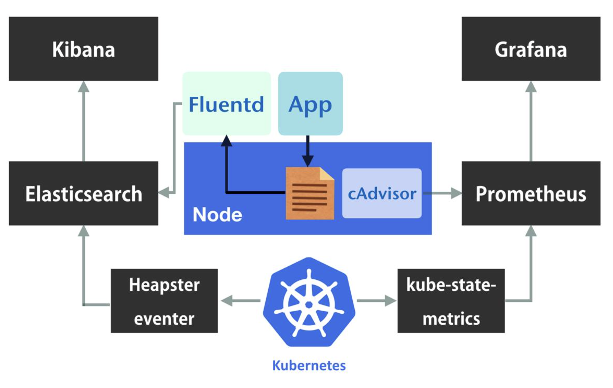

# Observability that supports on-call

## Signals

Metrics (Prometheus), logs (ELK/EFK) and traces tell different parts of the story; link them by shared labels.

## Alert on symptoms

Page on user-facing symptoms (error rate, latency, saturation), not on every cause.

```yaml
- alert: HighErrorRate
  expr: sum(rate(http_requests_total{code=~"5.."}[5m])) / sum(rate(http_requests_total[5m])) > 0.02
  for: 10m
  labels: {severity: page}
  annotations: {runbook_url: "https://example.com/runbooks/high-error-rate"}
```

## Habits

- Every page links to a runbook.
- Define SLOs and review the error budget monthly.
- Delete alerts nobody acts on.
